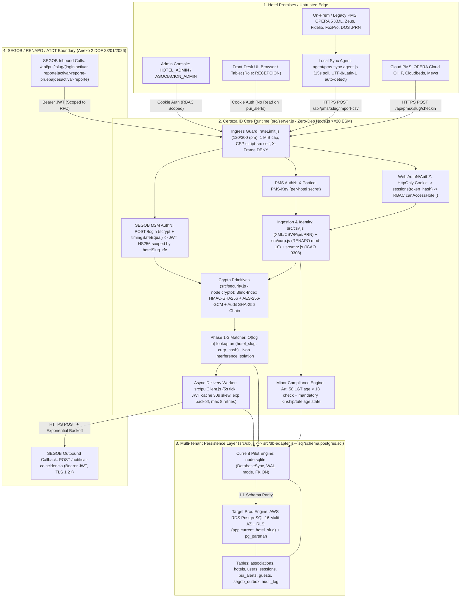
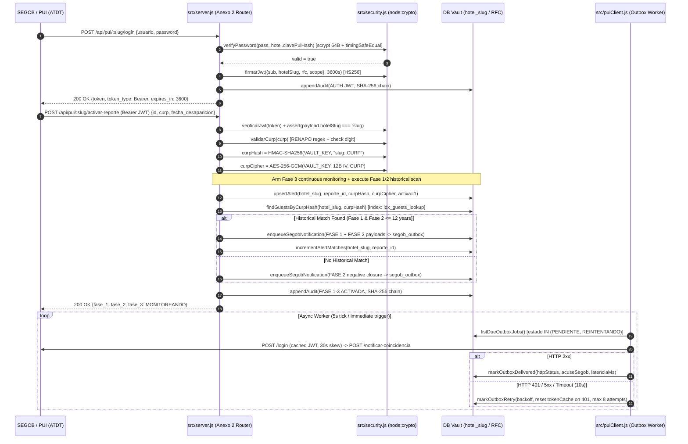
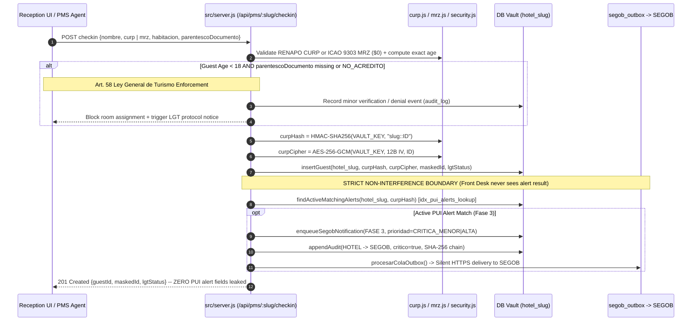

# Certeza ID — Arquitectura Técnica, Flujo Criptográfico y Threat Model (Engineering Spec)

Documento de referencia técnica basado estrictamente en el código implementado en el repositorio (`src/`, `agent/`, `sql/`, `test/pui.test.js` — `9/9` pruebas unitarias/integración pasando sobre Node.js ESM nativo con **cero dependencias npm externas**).

---

## 1. Topología del Sistema y Fronteras de Confianza (Trust Boundaries)

---

## 2. Flujo de Secuencia A — Activación Entrante de SEGOB (Fases 1, 2 Histórica 12 Años y Armado Fase 3)

---

## 3. Flujo de Secuencia B — Check-in en Tiempo Real, Propiedad de No-Interferencia (Sigilo) y Art. 58 LGT

---

## 4. Diseño Criptográfico y Modelo de Datos (Qué está cifrado vs. indexado)

| Entidad / Campo | Primitiva Real (`src/security.js`) | Propósito / Propiedad de Seguridad |
| :--- | :--- | :--- |
| `users.password_hash` / `hotels.clave_pui_hash` | `scrypt` (`64 B` output, `16 B` random salt) + `timingSafeEqual` | Resistente a fuerza bruta en GPU/ASIC y ataques de canal lateral por tiempo. |
| `sessions.token_hash` | `SHA-256` sobre token CSPRNG de `256 bits` (`randomBytes(32)`) | Un dump de la tabla `sessions` no permite secuestrar sesiones activas. |
| `guests.curp_hash` / `pui_alerts.curp_hash` | **Blind Index:** `HMAC-SHA256(VAULT_KEY, "${hotelSlug}::${curp}")` | Permite lookups exactos `O(log n)` sin almacenar CURP en texto plano y **rompe correlación entre distintos hoteles (RFCs)**. |
| `guests.curp_cifrada_json` / `pui_alerts.curp_cifrada_json` / `hotels.segob_clave_cifrada_json` | `AES-256-GCM` (`12 B` random IV + `16 B` auth tag) | Confidencialidad + integridad autenticada (AEAD) en reposo. |
| `audit_log.hash` | Cadena `SHA-256(prevHash \| JSON(record))` | Evidencia forense tamper-evident verificable con `verifyFullAuditChain()`. |
| Aislamiento Multi-Tenant (`sql/schema.postgres.sql`) | PostgreSQL 16 `ENABLE ROW LEVEL SECURITY` sobre `pui_alerts`, `guests`, `segob_outbox`, `audit_log` | Política `hotel_slug = current_setting('app.current_hotel_slug', true)` fijada con `SET LOCAL` por transacción en `withHotelRlsTransaction()`. |

---

## 5. Threat Model y Backlog Priorizado de Hardening (Lo que falta antes de PII real)

Diagnóstico directo de ingeniería sobre el código actual — **0 humo, brechas exactas con archivo y línea**:

### P0 — Bloqueantes antes del primer huésped real
1. **Envelope Encryption y eliminación de fallbacks dev (`src/security.js:11-14`):**
   - *Hallazgo actual:* `PUI_JWT_SECRET` y `PUI_VAULT_KEY` caen a strings hardcodeados si faltan env vars, y `VAULT_KEY` es única para todos los tenants.
   - *Fix requerido:* Fail-fast al arranque si `NODE_ENV=production` carece de secretos; integrar **AWS KMS** con **DEK por hotel** (cifrado de sobre) + columna `key_version` para rotación sin invalidar blind indexes `HMAC-SHA256`, y deshabilitar `isDemoModeEnabled()` + endpoints `/api/demo/*` en producción.
2. **Migración efectiva de `src/db.js` (SQLite) a `pg.Pool` + `FORCE ROW LEVEL SECURITY` + `SKIP LOCKED`:**
   - *Hallazgo actual:* `src/db.js` opera sobre `node:sqlite` (single-node); `src/db-adapter.js` define el wrapper transaccional RLS pero los queries aún no están cableados al driver `pg`.
   - *Fix requerido:* Cablear repositorio async sobre `pg.Pool` con rol no-superuser (`NOBYPASSRLS`) + `ALTER TABLE ... FORCE ROW LEVEL SECURITY`, usar `SELECT ... FOR UPDATE SKIP LOCKED` en `segob_outbox` para múltiples réplicas ECS/Fargate, y habilitar `pg_partman` mensual sobre `guests(fecha_registro)`.
3. **Aislamiento de red M2M y TLS estricto:**
   - *Fix requerido:* Terminación TLS 1.2+/1.3 con `Strict-Transport-Security`, **AWS WAF + IP Allowlist** (y mTLS si ATDT lo soporta) exclusivo para `/api/pui/*`.
4. **Hardening Web / AuthN:**
   - *Hallazgo actual:* `src/rateLimit.js` usa un `Map` en memoria de proceso; no hay MFA/2FA ni validación CSRF explícita para mutaciones autenticadas por cookie; la CSP en `src/server.js:92` bloquea fuentes externas si se sirve desde Node.
   - *Fix requerido:* Mover rate-limiting a **Redis** (sliding window atómico), exigir **TOTP MFA + account lockout** en `ASOCIACION_ADMIN` / `HOTEL_ADMIN`, agregar verificación `Origin` + CSRF token, y alojar tipografías localmente en `public/assets/fonts/`.
5. **Hardening del Agente Local en PC de Recepción (`agent/pms-sync-agent.js`):**
   - *Hallazgo actual:* Permite `http://` por defecto (`line 139`) y mueve los CSV/XML originales con CURPs en texto plano a `processed/` y `failed/` (`lines 99–111`).
   - *Fix requerido:* Exigir `https://` obligatorio con verificación TLS estricta en producción, borrado seguro (`unlink` / shred) tras confirmación HTTP `200` (o retención cifrada breve) para no dejar PII en claro en discos de mostrador, y rotación automática de `X-Portico-PMS-Key`.

### P1 — Certificación ATDT (Sección 8) y Validación de Fuentes
6. **Validación exacta de contrato contra Sandbox real ATDT (`SG_230126_VES_02.pdf`):** Confirmar payload exacto, HTTP codes, JWT signing algorithm (`HS256` vs `RS256` / JWKS si lo requiere ATDT) y URLs reales de callback en `/activar-reporte-prueba`.
7. **Verificación de autenticidad RFC / CURP:** Validar cadena X.509 de certificado público `.cer` del SAT (o QR de Constancia de Situación Fiscal) al registrar cada hotel, más adaptador opcional de consulta en vivo a **RENAPO / Lista Nominal INE** para clientes que soliciten validación Nivel 3.
8. **Pipeline Sección 8 + LFPDPPP:** Integrar **SAST** (Semgrep/CodeQL), **DAST** (OWASP ZAP) y **SCA** (Trivy sobre imagen Docker) en CI/CD con gate cero críticos/altos, y formalizar contrato de Encargado de Tratamiento de Datos (LFPDPPP) con cada hotel.
