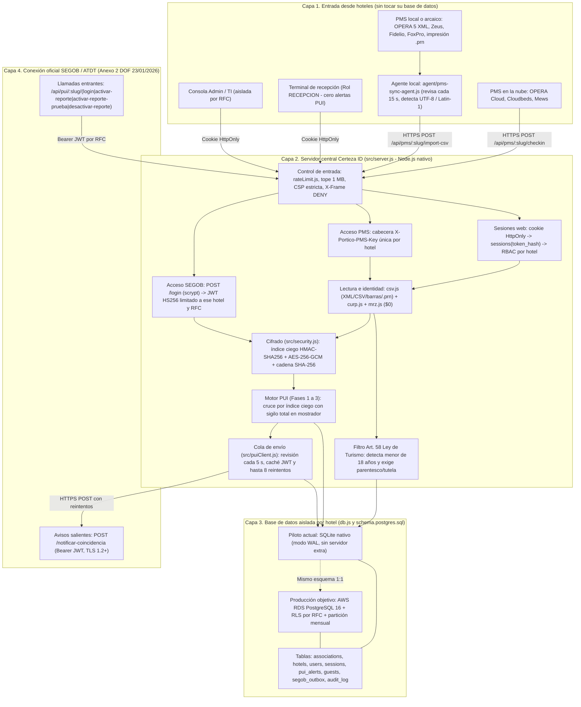
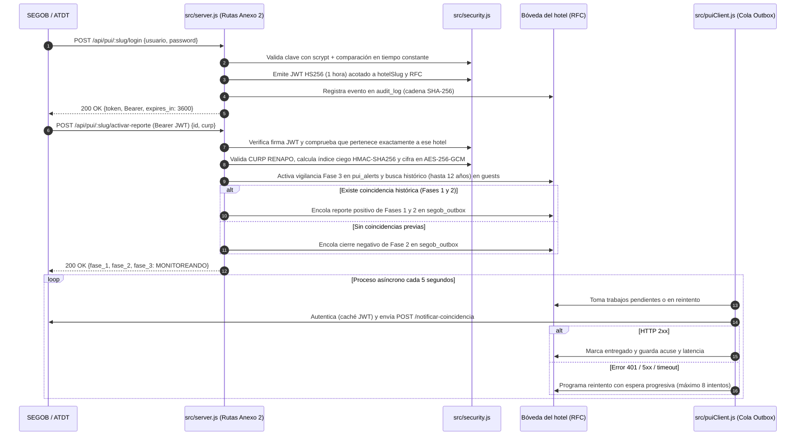
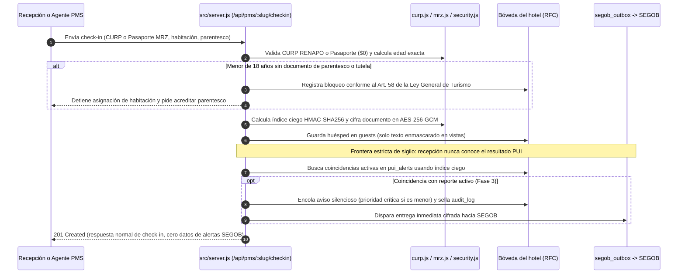

# Certeza ID — Arquitectura Técnica, Seguridad Criptográfica y Plan de Producción

Documento de ingeniería en español basado exactamente en el código implementado en `src/`, `agent/` y `sql/` (Node.js >=20 ESM nativo, **cero dependencias npm externas**, `9/9` pruebas pasando en `test/pui.test.js`).

---

## 0. Marco Legal y Especificación Oficial PUI (Fuentes Directas)

| Instrumento oficial | Fecha | Qué exige al sistema | Enlace directo |
| :--- | :--- | :--- | :--- |
| **Manual Técnico PUI (Anexo 2 y Sec. 8)** | 23 ene 2026 | Define los 4 endpoints API (`/login`, `/activar-reporte`, `/activar-reporte-prueba`, `/desactivar-reporte`), histórico de 12 años, TLS 1.2+, JWT, AES-256-GCM y auditoría SAST/DAST/SCA. | [PDF Oficial DOF](https://dof.gob.mx/2026/GOBERNACION/SG_230126_VES_02.pdf) · [Portal ATDT](https://www.plataformadebusqueda.gob.mx/inscripcion) |
| **Reforma LGMDFP (Arts. 12 Bis y 43 Bis)** | 16 jul 2025 | Crea la PUI, obliga a hoteles y moteles y fija multas de 10,000 a 20,000 UMAs (\$1.17M a \$2.34M MXN por hotel). | [DOF 5763157](https://dof.gob.mx/nota_detalle.php?codigo=5763157&fecha=16/07/2025) · [Llave MX](https://www.llave.gob.mx/) |
| **Lineamientos de Operación PUI** | 27 nov 2025 | Monitoreo continuo de CURP, envío silencioso, cifrado, bitácoras y prohibición de descargar el padrón real del RNPDNO. | [DOF 5774120](https://dof.gob.mx/nota_detalle.php?codigo=5774120&fecha=27/11/2025) |
| **Ley General de Turismo (Art. 58 X Bis/Ter)** | 13 nov 2026 | Verificación obligatoria de parentesco/tutela para menores de 18 años en hoteles; negar hospedaje y avisar si no se acredita. | [DOF 5803838](https://dof.gob.mx/nota_detalle.php?codigo=5803838&fecha=13/11/2026) |
| **LFPDPPP (Protección de Datos)** | Vigente | Bóveda cifrada e independiente por RFC y borrado automático de datos personales vencidos. | [Ley Federal](https://www.diputados.gob.mx/LeyesBiblio/pdf/LFPDPPP.pdf) |

---

## 1. Mapa de Arquitectura y Fronteras de Seguridad

---

## 2. Flujo A — Cuando SEGOB envía un reporte (Fases 1, 2 histórica y 3 en vivo)

---

## 3. Flujo B — Cuando llega un huésped (Check-in, menores y sigilo en mostrador)

---

## 4. Lista de Endurecimiento Obligatorio Antes de Producción Real

### Prioridad 1 (bloqueantes antes del primer huésped real)
1. **Quitar llaves de prueba y usar AWS KMS (`src/security.js:11-14`):** hacer que el servidor falle al arrancar si faltan secretos en producción, usar **AWS KMS con una clave de datos por hotel** (con `key_version` para rotar sin romper búsquedas `HMAC-SHA256`) y apagar `PORTICO_DEMO_MODE` y las rutas `/api/demo/*`.
2. **Conectar PostgreSQL 16 real + RLS + `SKIP LOCKED`:** migrar los queries de `src/db.js` (SQLite) al driver real `pg` en AWS RDS usando un rol `NOBYPASSRLS` + `FORCE ROW LEVEL SECURITY`, aplicar `SELECT ... FOR UPDATE SKIP LOCKED` en `segob_outbox` para múltiples réplicas y activar particionamiento mensual (`pg_partman`) en `guests`.
3. **Blindaje de red exclusivo para SEGOB:** TLS 1.2+/1.3 obligatorio con cabecera `Strict-Transport-Security`, **AWS WAF + lista blanca de IPs de SEGOB/ATDT** (y mTLS si la autoridad lo soporta) en `/api/pui/*`.
4. **Acceso seguro, 2FA, CSRF y límite en Redis:** mover `src/rateLimit.js` a **Redis**, exigir **doble factor (2FA / TOTP) y bloqueo por intentos fallidos** en cuentas `ASOCIACION_ADMIN` y `HOTEL_ADMIN`, agregar validación de origen + token CSRF en acciones con cookie y servir las fuentes localmente.
5. **Endurecer el agente local (`agent/pms-sync-agent.js`):** exigir `https://` con verificación estricta de certificado (eliminar `http://` por defecto), borrar de forma segura los CSV/XML procesados tras recibir HTTP `200` (cero CURPs en texto plano en la PC de recepción) y rotar llaves PMS periódicamente.
6. **Validar contrato real en Sandbox ATDT (`SG_230126_VES_02.pdf`):** confirmar nombres exactos de campos, códigos HTTP, algoritmo JWT (`HS256` vs `RS256`) y URLs reales de callback al activar el primer hotel piloto con Llave MX y e.firma.

### Siguientes mejoras recomendadas
7. **Autenticidad de RFC (SAT):** validar certificado público `.cer` del SAT o QR de Constancia de Situación Fiscal al dar de alta cada hotel real.
8. **Consulta opcional RENAPO / INE (Nivel 3):** adaptador desacoplado para hoteles que soliciten verificar vigencia y titularidad oficial de la CURP en vivo.
9. **Auditoría Sección 8 y LFPDPPP:** correr escaneo formal SAST, DAST y SCA en CI/CD (cero hallazgos críticos/altos) y formalizar contrato de Encargado de Tratamiento de Datos con cada hotel.
